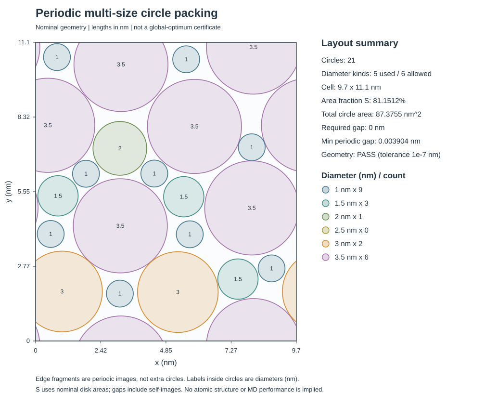
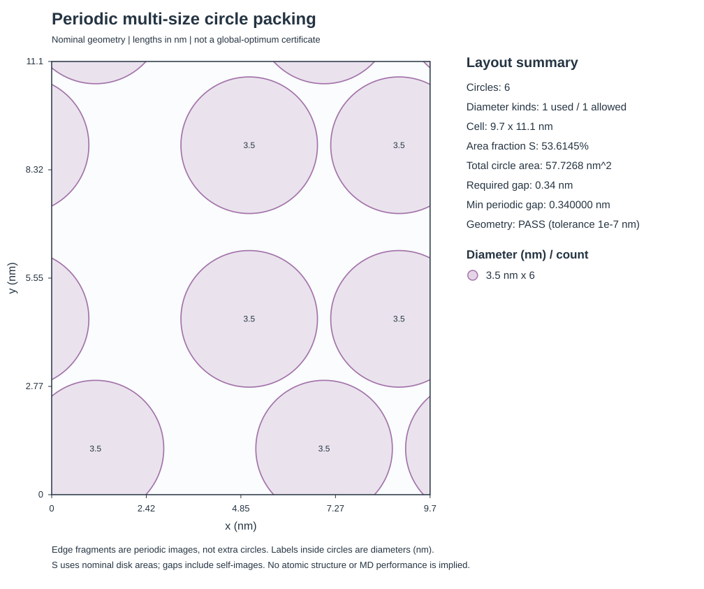
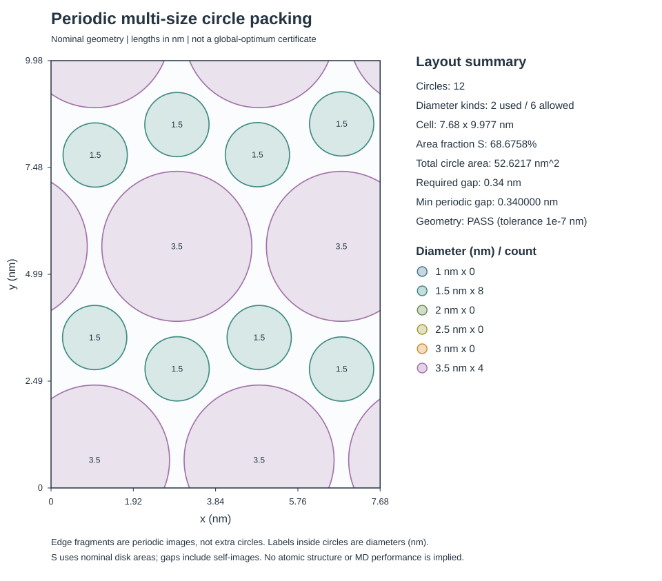
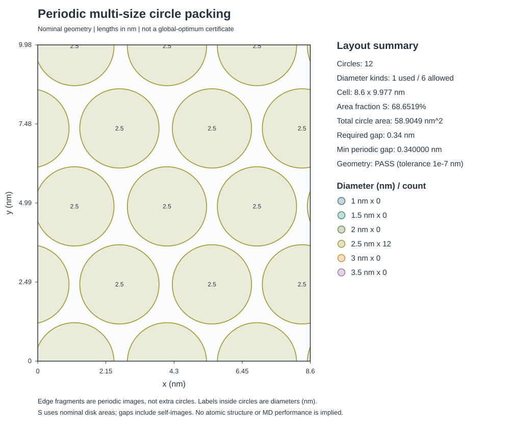
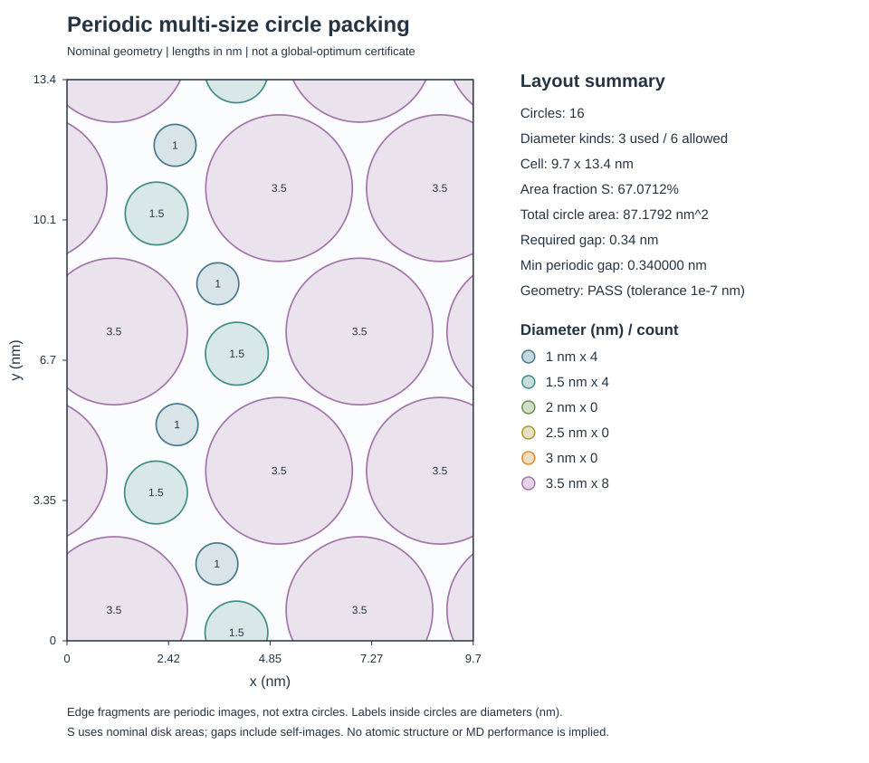
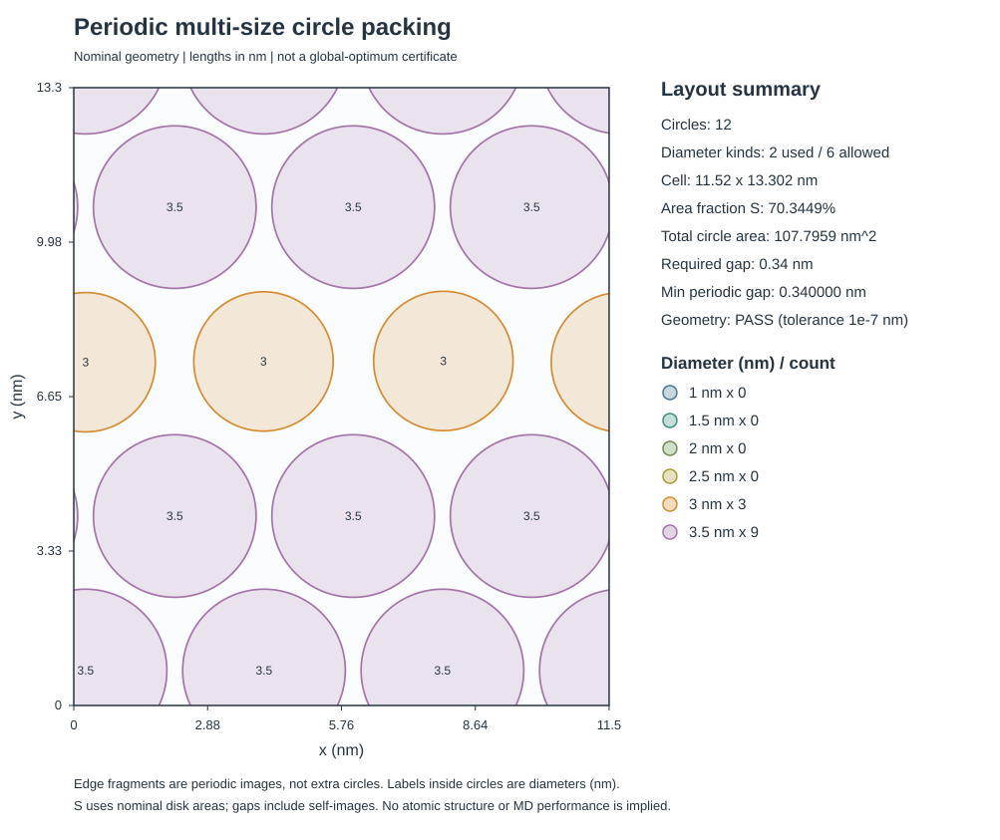
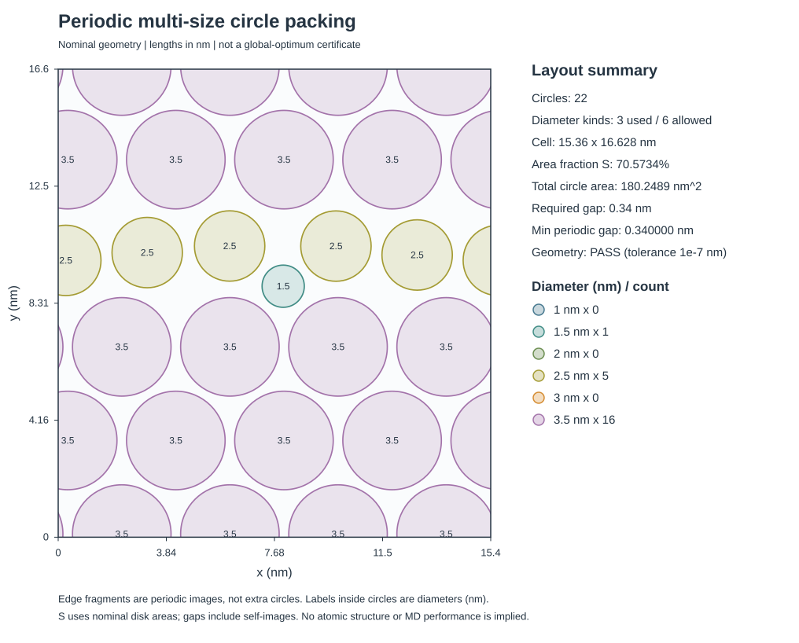

# PMSCPC 
#### 周期矩形内离散多尺寸、数量可变且带最小间距约束的最大面积圆填充问题

原问题设定：
- 在固定矩形（默认 **9.7 × 11.1 nm**）内放置**若干**圆,矩形采用**周期性边界条件**，按环面拓扑处理。
- 圆直径从 **1.0、1.5、2.0、2.5、3.0、3.5 nm** 六档中选取
- 任意两圆表面间距至少 **0.34 nm**

优化目标是选择各圆直径与圆心位置，使圆面积总和 `S = Σπr_i²` 最大，等价于最大化总填充率。

算法详细细节见 [ALGORITHM](ALGORITHM.md)

## 仓库内容

| 文件 | 作用 |
|---|---|
| `main.py` | ShinkaEvolve 多轮搜索所得的最佳程序原样副本，负责生成、搜索排布 |
| `run.py` | 独立命令行入口，负责参数解析、几何检查、CSV 导出与 SVG 绘图 |

SVG 由 Python 标准库生成，浏览器或 Inkscape 可打开。

## 默认参数

| 项目 | 默认值 | 对应 CLI 参数／写法 |
|---|---|---|
| 容器 | 9.7 × 11.1 nm | `--box-w 9.7 --box-h 11.1` |
| 允许直径 | 1、1.5、2、2.5、3、3.5 nm | `--diameters 1 1.5 2 2.5 3 3.5`用空格分隔|
| 最小圆表面间距 | 0.34 nm | `--gap 0.34`等价写法：`--safety-gap 0.34` |
| seed | 17 | `--seed 17`seed对应一次可复现的搜索过程 |
| 长度单位 | nm；转为 Å 需乘 10 | 固定为 nm |

## 快速开始（PowerShell）

```powershell
cd D:\PMSCPC
python --version
python -B run.py --help  #请先查看帮助，有具体CLI参数说明
```
```
批量测试seed从79到81
foreach ($s in 79..81) {
    python -B run.py --seed $s --diameters 1 1.5 2 2.5 3 3.5 --gap 0.34 --output "runs/batch02/seed_$s"
}
```
## 输出文件

一次搜索输出三份配套文件，同一组坐标直接用于绘图，不重复搜索：

```text
runs/A_seed17.csv    # x_nm,y_nm,diameter_nm
runs/A_seed17.svg    # 周期排布图 + 直径数量图例 + 几何摘要
runs/A_seed17.json   # 参数、各档数量、S、间距、来源指纹等记录
```

## 注意事项

- `--output` 只需给出前缀，不要加 `.csv` 或 `.svg`。
- 父目录runs会自动创建。
- 若同名前缀的 CSV/SVG/JSON 已存在，程序会停止，**不覆盖、不重新搜索**。再做一次请换前缀，例如 `runs/A_seed17_v2`。

## 其他参数下的一些有趣排布

`gallery/` 下是同一构造器在不同参数下的输出。每张图都是一个周期单元，边缘碎片是镜像，不是额外的圆；点缩略图可看原尺寸。

| 预览 | 参数 | 看点 |
|:--:|---|---|
| <a href="gallery/touching.svg"></a> | `9.7 × 11.1` · 21 圆 · S = 81.15%<br>`3.5 × 6` + `3.0 × 2` + `2.0 × 1` + `1.5 × 3` + `1.0 × 9` | `--gap 0`，五档同时上场 |
| <a href="gallery/only35.svg"></a> | `9.7 × 11.1` · 6 圆 · S = 53.61%<br>`3.5 × 6` | 纯六方基线：只准用最大直径 |
| <a href="gallery/hex_2x3.svg"></a> | `7.68 × 9.977` · 12 圆 · S = 68.68%<br>`3.5 × 4` + `1.5 × 8` | 窄盒只排得下 2 行，余量全给小圆 |
| <a href="gallery/seam_wide.svg"></a> | `8.6 × 9.977` · 12 圆 · S = 68.65%<br>`2.5 × 12` | 骨架整体从 3.5 换成 2.5 |
| <a href="gallery/four_rows.svg"></a> | `9.7 × 13.4` · 16 圆 · S = 67.07%<br>`3.5 × 8` + `1.5 × 4` + `1.0 × 4` | 四行成立，S 反而没升 |
| <a href="gallery/hex_3x4.svg"></a> | `11.52 × 13.302` · 12 圆 · S = 70.34%<br>`3.5 × 9` + `3.0 × 3` | 比四行所需短 0.0002 nm，第四行没排上 |
| <a href="gallery/hex_4x5.svg"></a> | `15.36 × 16.628` · 22 圆 · S = 70.57%<br>`3.5 × 16` + `2.5 × 5` + `1.5 × 1` | 四行 × 四列，图库里 S 最高 |


