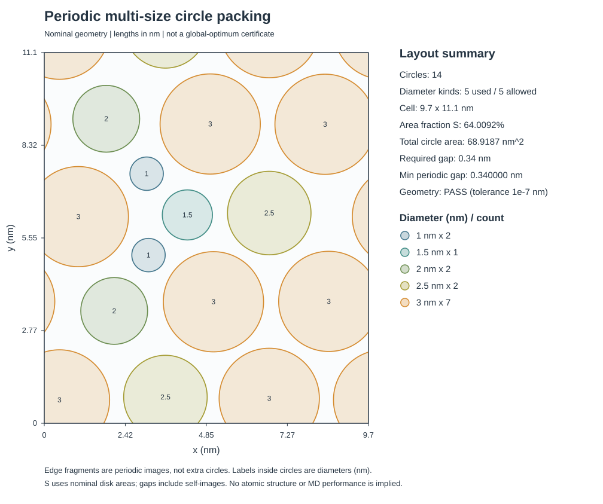

# B 构型 · 口径上限 3.0 nm

B 是 [PMSCPC](../README.md) 中的限径排布。盒子沿 $x$ 和 $y$ 周期重复，尺寸为 9.7 × 11.1 nm。允许直径为 1.0、1.5、2.0、2.5 和 3.0 nm，要求圆表面最小间距为 0.34 nm。



图中的边缘圆片是相邻周期单元的镜像。圆面积占比 $S$ 使用标称直径计算，最小间距也基于标称圆。种子 17 对应 14 根管，**S = 64.009184395%**。

## 快速开始

从仓库根目录运行。只需要 Python 3.10 或更新版本及其标准库。

```sh
python -B b_dmax3/run_b.py --help
python -B b_dmax3/run_b.py --verify
python -B b_dmax3/run_b.py --seeds 17 --out runs/b_dmax3
```

`--verify` 运行一次构造器，比较参考排布的每个周期圆心及直径。有多个圆跨越边界时，圆心按周期最小镜像比较。生成命令为每个种子输出 `seed_<seed>.csv`、`.svg` 和 `.json`，分别提供坐标、排布图、参数和几何核验结果。可合用 `--verify --seeds 17`，共用一次求解。已有同名输出时请换一个 `--out`。

已有 CSV 可直接检查及绘图，两种表头均以 nm 为单位。参考文件使用 `circle_id,x,y,diameter`，导出使用 `x_nm,y_nm,diameter_nm`。

```sh
python -B b_dmax3/run_b.py --input-csv b_dmax3/candidate_14.csv --out runs/b_dmax3/preview
```

## 批量扫种子

```sh
python -B b_dmax3/sweep.py --help
python -B b_dmax3/sweep.py --start 200 --count 4 --workers 2 --out runs/b_dmax3/sweep
```

`summary.csv` 汇总每个成功种子的 $S$、口径组成和最小间距，`layouts.jsonl` 保留坐标，`hit_<seed>.csv` 导出 $S$ 达到参考值的候选。汇总的 `equivalence_group` 按直径及舍入后的周期成对距离分组，用于初筛。相同 $S$ 仍可能对应不同坐标，分组也只是几何指纹。

## 文件来源

- [constructor_gen6.py](constructor_gen6.py) 是 ShinkaEvolve 搜索中第 6 代的 B 构造程序。
- [candidate_14.csv](candidate_14.csv) 是种子 17 对应的参考坐标。
- [B_seed17.svg](B_seed17.svg) 从参考 CSV 绘制，沿用仓库根目录 [run.py](../run.py) 的几何校验、比例和配色。

这里的命令运行已保存的构造器和几何核验，供参考排布复现。完整进化搜索与 LAMMPS 模拟各有独立流程。

